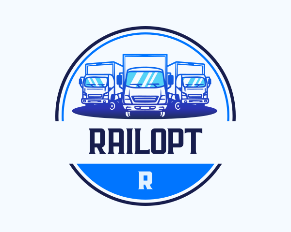

# Railopt



**Railopt** je namizna aplikacija za načrtovanje, primerjavo in spremljanje prevozov tovora po cesti in železnici. Namenjena je ekipi TIM Hekaton in projektu »Cesta ali vlak?«.

## Zakaj je projekt nastal

Izhodišče je bil izziv TIM Hekaton 2026: za izbrane relacije ugotoviti, ali je pošiljko ugodneje, hitreje ali z manj emisijami prepeljati s tovornjakom ali vključiti železnico. Začetne primerjave so bile v Excelu in vezane na nekaj vnaprej pripravljenih primerov. To je oteževalo primerjavo novih krajev, rokov, tež in tipov enot.

Railopt je nastal, da te podatke in izračune združi v eno orodje: uporabnik vnese konkretno pošiljko, primerja možne načine prevoza, pregleda časovnico ter shrani rezultat v skupno podatkovno bazo.

## Kaj aplikacija omogoča

- **Pregled poslovanja** — povzetek pošiljk, relacij, izračunov, emisij in izbranih načinov prevoza.
- **Planer dostave** — vnos kraja naklada in dostave, časa ter roka, teže, enote in ADR tovora. Izračuna predviden prihod ali najpoznejši začetek naklada.
- **Primerjava prevozov** — primerjava cestnega prevoza, intermodalne kombinacije cesta–vlak in prevoza Ro-La, kjer je za tovor na vlaku.
- **Čas in stroški** — časovnica vključuje cestne etape, nakladanje, železniški del in odmore voznika; stroški se izračunajo iz nastavljenih parametrov, cenikov in razpoložljivih podatkov.
- **Emisije CO₂e** — izračun glede na tonske kilometre in uporabljene emisijske faktorje. Privzeti cestni faktor je 0,095 kg CO₂e/tkm; nastavljive parametre lahko ureja skrbnik.
- **Zemljevid terminalov in poti** — prikaz terminalov ter cestnih in železniških odsekov izračunane poti.
- **Prazniki in motnje** — upravljanje praznikov ter cestnih in železniških zapor; planer jih uporabi pri oceni izvedljivosti oziroma obvoza.
- **Relacije in zgodovina** — shranjevanje, urejanje, ponovni izračun in izvoz podatkov.
- **Poslovni potek** — spremljanje pošiljke od ponudbe do obračuna, vnos prevoznika, strank, prodajne cene, stroška in številke računa ter priprava dokumentov.
- **Oprema in uporabniki** — katalog enot, terminalske združljivosti, uporabniški računi, vloge in dovoljenja.
- **Uvoz in izvoz** — uvoz Excelovih podatkov ter izvoz pošiljk, relacij in zgodovine v CSV ali PDF; zgodovino je mogoče shraniti tudi kot JSON arhiv.
- **Svetli in temni način** — vmesnik je prilagojen tudi ozkim oknom.

## Kako brati rezultate

Rezultati so **načrtovalne ocene**, ne potrjene ponudbe prevoznikov ali rezervacije. Razdalja in trajanje cestne poti uporabljata podatke OpenStreetMap ter javna usmerjevalnika. Če nista dosegljiva, aplikacija prikaže opozorilo in uporabi približno oceno. Usmerjanje ni nadomestilo za preverjanje vseh zakonskih omejitev za konkretno tovorno vozilo.

Železniške povezave in termini so iz lokalnega podatkovnega nabora, ne iz sprotne povezave z operaterjem. Datumi veljavnosti so navedeni v `backend/data/kombiverkehr-network.json`; pred operativno uporabo je treba vozni red, terminale, tarife in razpoložljivost preveriti pri prevozniku. Izračun pokaže primerljive možnosti, ne rezervira prevoza.

## Tehnologije

- **Namizni vmesnik:** Electron
- **Uporabniški vmesnik:** Angular, TypeScript, SCSS
- **API:** Node.js, Express
- **Podatkovna baza:** MySQL
- **Geokodiranje in cestno usmerjanje:** Photon in usmerjevalnika na osnovi OpenStreetMap
- **Zemljevid:** Leaflet/OpenStreetMap

Electron komunicira z lokalnim API-jem; do MySQL se povezuje samo strežniški del.

## Zagon za razvoj

### Zahteve

- Node.js in npm
- MySQL
- Windows za namizni Electron paket (Angular in API je mogoče razvijati tudi ločeno)
- Internetna povezava za iskanje krajev in cestno usmerjanje

### Namestitev odvisnosti

V korenski mapi projekta namesti pakete za Electron, Angular in API:

```powershell
npm ci
npm --prefix frontend ci
npm --prefix backend ci
```

### Podatkovna baza

Za **novo** namestitev ustvari osnovno bazo `railopt` in dodatne tabele. Iz PowerShella zaženi SQL skripte v tem vrstnem redu z MySQL skrbniškim računom:

```powershell
Get-Content -Raw createdb.sql | mysql -u root -p
Get-Content -Raw migrations/002_delivery_plans.sql | mysql -u root -p railopt
```

Za prijavne račune ustvari bazo in tabelo, če ju še nimaš:

```sql
CREATE DATABASE IF NOT EXISTS prevozi CHARACTER SET utf8mb4 COLLATE utf8mb4_unicode_ci;
CREATE TABLE IF NOT EXISTS prevozi.users (
  id CHAR(36) NOT NULL PRIMARY KEY,
  username VARCHAR(50) NOT NULL UNIQUE,
  email VARCHAR(255) NOT NULL UNIQUE,
  password VARCHAR(255) NOT NULL,
  role VARCHAR(20) NOT NULL DEFAULT '2',
  created_at TIMESTAMP NOT NULL DEFAULT CURRENT_TIMESTAMP
);
```

Nato dodaj vloge in operativne tabele:

```powershell
Get-Content -Raw migrations/003_roles_and_operations.sql | mysql -u root -p
Get-Content -Raw migrations/004_kombiverkehr_network.sql | mysql -u root -p railopt
```

Aplikacija privzeto uporablja `railopt` za transportne podatke ter `prevozi` za uporabniške račune in vloge. Stolpec `password` vsebuje bcrypt zgoščene vrednosti; strežnik podpira tudi stolpec `password_hash`. Migracija `003_roles_and_operations.sql` doda tabelo vlog in operativne tabele, ne ustvari pa začetne tabele `users`.

`createdb.sql` je namenjen novi bazi in vsebuje `CREATE TABLE` ukaze brez splošnega `IF NOT EXISTS`; ne zaganjaj ga ponovno nad obstoječo bazo. `migrations/001_uuid_users.sql` je ločena enkratna migracija za obstoječo shemo. Pred njo je treba narediti varnostno kopijo in preveriti navodila v sami migraciji; ni del običajne namestitve.

### Nastavitve in prvi skrbnik

Kopiraj predlogo nastavitev in jo dopolni lokalno:

```powershell
Copy-Item .env.example backend/.env
```

V `backend/.env` nastavi MySQL uporabnika in geslo. Privzeti imeni baz sta `railopt` in `prevozi`; po potrebi ju spremeni z `MYSQL_DATABASE` in `MYSQL_AUTH_DATABASE`. Datoteka `backend/.env` je izključena iz Gita.

Če tabela uporabnikov še nima skrbnika, lahko za prvo inicializacijo nastaviš `RAILOPT_ADMIN_EMAIL` in `RAILOPT_ADMIN_PASSWORD` (najmanj 12 znakov), po želji tudi `RAILOPT_ADMIN_USERNAME`. Ob zagonu se začetni skrbnik ustvari samo, če ga baza še nima. Te vrednosti ostanejo lokalne in jih ne objavi v repozitoriju.

Zaženi celotno razvojno aplikacijo:

```powershell
npm run dev
```

Ukaz zažene API, Angular razvojni strežnik in Electron. API posluša na `http://127.0.0.1:8080`, Angular razvojni vmesnik pa na `http://127.0.0.1:4200`.

### Excelovi podatki

Skrbnik lahko Excelovo datoteko uvozi v aplikaciji pod **Zgodovina → Uvoz Excelovega delovnega zvezka**. Uvoz zapolni relacije, pošiljke, parametre in praznike; ponovni uvoz posodobi ujemajoče se zapise. Excel je vir vhodnih podatkov in referenčnih vrednosti, aplikacija pa nato računa za vnesene relacije in datume.

## Gradnja namestitvenega paketa

```powershell
npm run build
```

Ukaz zgradi Angular vmesnik in z Electron Builderjem pripravi Windows namestitveni paket v `release/`.

## Razvojni prijavni gumb

V razvojni različici je na prijavnem zaslonu na voljo **Nadaljuj brez prijave (razvoj)**. API razvojno sejo zavrne, kadar je `NODE_ENV=production`. Pred produkcijsko objavo preveri nastavitev okolja in jo pusti izklopljeno.

## Varnost

- Nikoli ne objavi `backend/.env`, gesel, MySQL poverilnic, sejnih žetonov ali izvozov, ki vsebujejo poslovne podatke.
- Gesla uporabnikov se shranjujejo kot bcrypt zgoščene vrednosti; skrbnik upravlja račune v aplikaciji.
- Migracije baze izvajaj z ločenim skrbniškim MySQL računom. Aplikacijski račun naj ima samo pravice, ki jih potrebuje za delovanje.
- Preveri dovoljene uporabnike, vloge, podatkovne kopije in nastavitve okolja pred uporabo na produkcijskih podatkih.

## Zunanji viri in navedbe

- [OpenStreetMap](https://www.openstreetmap.org/) — podatki zemljevida in cestnega omrežja; vmesnik prikaže navedbo avtorstva.
- [Photon](https://photon.komoot.io/) — iskanje krajev.
- [Kombiverkehr](https://www.kombiverkehr.de/en/timetable-information) — referenčni vir za železniške povezave; lokalni nabor v projektu ima označeno obdobje veljavnosti.
- Ro-La tarife in del transportnih parametrov temeljijo na projektnih Excelovih vhodnih podatkih.
